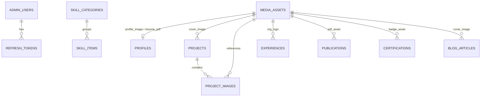

# Database Schema and Persistence (`PostgreSQL`)

**Database Engine:** PostgreSQL 16+  
**ORM:** Entity Framework Core (Code-First Migrations with `Npgsql.EntityFrameworkCore.PostgreSQL`)  
**Naming Convention:** `snake_case` tables and columns via `EFCore.NamingConventions`.

## 1. Entity-Relationship Overview

## 2. Core Tables

### `admin_users`
- `id` (`uuid`, PK)
- `email` (`varchar(256)`, unique, not null)
- `display_name` (`varchar(150)`, not null)
- `password_hash` (`text`, not null)
- `failed_login_count` (`int`, not null, default 0)
- `lockout_end_utc` (`timestamptz`, nullable)
- `created_at_utc`, `updated_at_utc` (`timestamptz`)

### `refresh_tokens`
- `id` (`uuid`, PK)
- `admin_user_id` (`uuid`, FK -> `admin_users.id`)
- `token_hash` (`varchar(128)`, unique index, not null)
- `expires_at_utc` (`timestamptz`, not null)
- `created_at_utc` (`timestamptz`, not null)
- `revoked_at_utc` (`timestamptz`, nullable)
- `replaced_by_token_hash` (`varchar(128)`, nullable)

### `media_assets`
- `id` (`uuid`, PK)
- `original_file_name` (`varchar(255)`, not null)
- `storage_key` (`varchar(500)`, unique, not null)
- `public_url` (`varchar(1000)`, not null)
- `content_type` (`varchar(100)`, not null)
- `size_bytes` (`bigint`, not null)
- `width` (`int`, nullable), `height` (`int`, nullable)
- `alt_text` (`varchar(300)`, not null, default `''`)
- `created_at_utc` (`timestamptz`, not null)

### `profiles`
- `id` (`uuid`, PK)
- `display_name` (`varchar(150)`, not null)
- `headline` (`varchar(250)`, not null)
- `short_intro` (`varchar(600)`, not null)
- `biography_markdown` (`text`, not null)
- `working_approach_markdown` (`text`, nullable)
- `public_email` (`varchar(256)`, nullable)
- `show_email_publicly` (`boolean`, not null, default false)
- `profile_image_asset_id` (`uuid`, nullable, FK -> `media_assets.id`)
- `resume_pdf_asset_id` (`uuid`, nullable, FK -> `media_assets.id`)
- `social_links_json` (`jsonb`, not null, default `'[]'`)
- `seo_title` (`varchar(160)`, nullable)
- `seo_description` (`varchar(320)`, nullable)
- `updated_at_utc` (`timestamptz`, not null)

### `experiences`
- `id` (`uuid`, PK)
- `organization` (`varchar(200)`, not null)
- `organization_logo_asset_id` (`uuid`, nullable, FK -> `media_assets.id`)
- `role_title` (`varchar(200)`, not null)
- `employment_type` (`varchar(80)`, nullable)
- `location` (`varchar(150)`, nullable)
- `work_arrangement` (`varchar(80)`, nullable)
- `start_date` (`date`, not null)
- `end_date` (`date`, nullable)
- `is_current` (`boolean`, not null, default false)
- `summary` (`text`, not null)
- `responsibilities_json` (`jsonb`, not null, default `'[]'`)
- `outcomes_json` (`jsonb`, not null, default `'[]'`)
- `technology_tags` (`text[]`, not null, default `'{}'`)
- `display_order` (`int`, not null, default 0)
- `status` (`varchar(20)`, not null, default `'Draft'`)
- `created_at_utc`, `updated_at_utc` (`timestamptz`)

### `projects`
- `id` (`uuid`, PK)
- `slug` (`varchar(200)`, unique, not null)
- `title` (`varchar(200)`, not null)
- `short_summary` (`varchar(500)`, not null)
- `category` (`varchar(100)`, not null)
- `problem_context_markdown` (`text`, nullable)
- `goals_markdown` (`text`, nullable)
- `role_contributions_markdown` (`text`, nullable)
- `architecture_overview_markdown` (`text`, nullable)
- `challenges_decisions_markdown` (`text`, nullable)
- `outcomes_markdown` (`text`, nullable)
- `technology_tags` (`text[]`, not null, default `'{}'`)
- `cover_image_asset_id` (`uuid`, nullable, FK -> `media_assets.id`)
- `live_demo_url` (`varchar(500)`, nullable)
- `repository_url` (`varchar(500)`, nullable)
- `is_featured` (`boolean`, not null, default false)
- `display_order` (`int`, not null, default 0)
- `status` (`varchar(20)`, not null, default `'Draft'`)
- `published_at_utc` (`timestamptz`, nullable)
- `seo_title` (`varchar(160)`, nullable)
- `seo_description` (`varchar(320)`, nullable)
- `created_at_utc`, `updated_at_utc` (`timestamptz`)

### `project_images`
- `id` (`uuid`, PK)
- `project_id` (`uuid`, FK -> `projects.id` ON DELETE CASCADE)
- `media_asset_id` (`uuid`, FK -> `media_assets.id` ON DELETE RESTRICT)
- `caption` (`varchar(300)`, nullable)
- `display_order` (`int`, not null, default 0)

### `skill_categories` & `skill_items`
- `skill_categories`: `id` (`uuid`, PK), `name` (`varchar(120)`), `slug` (`varchar(120)`), `description` (`varchar(300)`), `display_order` (`int`), `is_visible` (`boolean`).
- `skill_items`: `id` (`uuid`, PK), `category_id` (`uuid`, FK), `name` (`varchar(100)`), `context_description` (`varchar(300)`), `display_order` (`int`), `is_visible` (`boolean`).

### `educations`
- `id` (`uuid`, PK), `institution` (`varchar(250)`), `degree` (`varchar(200)`), `department` (`varchar(200)`), `start_date` (`date`), `end_date` (`date`, nullable), `is_current` (`boolean`), `result_text` (`varchar(100)`, nullable), `show_result_publicly` (`boolean`, default false), `description` (`text`, nullable), `institution_url` (`varchar(500)`, nullable), `display_order` (`int`), `status` (`varchar(20)`), timestamps.

### `publications`
- `id` (`uuid`, PK), `slug` (`varchar(200)`, unique), `title` (`varchar(400)`), `authors_json` (`jsonb`), `venue` (`varchar(300)`), `publication_year` (`int`), `publication_date` (`date`, nullable), `doi` (`varchar(150)`, nullable), `official_url` (`varchar(500)`, nullable), `pdf_asset_id` (`uuid`, nullable, FK -> `media_assets.id`), `abstract_text` (`text`, nullable), `display_order` (`int`), `status` (`varchar(20)`), timestamps.

### `certifications`
- `id` (`uuid`, PK), `title` (`varchar(250)`), `issuer` (`varchar(200)`), `issue_date` (`date`), `credential_id` (`varchar(150)`, nullable), `credential_url` (`varchar(500)`, nullable), `description` (`text`, nullable), `badge_asset_id` (`uuid`, nullable, FK -> `media_assets.id`), `display_order` (`int`), `status` (`varchar(20)`), timestamps.

### `blog_articles` (Optional)
- `id` (`uuid`, PK), `slug` (`varchar(200)`, unique), `title` (`varchar(250)`), `summary` (`varchar(500)`), `content_markdown` (`text`), `cover_image_asset_id` (`uuid`, nullable), `tags` (`text[]`), `reading_time_minutes` (`int`), `status` (`varchar(20)`), `published_at_utc`, `created_at_utc`, `updated_at_utc`.

### `contact_messages`
- `id` (`uuid`, PK), `sender_name` (`varchar(150)`), `sender_email` (`varchar(256)`), `subject` (`varchar(250)`, nullable), `message_body` (`text`), `status` (`varchar(20)`, default `'Unread'`), `ip_hash` (`varchar(64)`, nullable), `user_agent` (`varchar(300)`, nullable), `created_at_utc` (`timestamptz`), `read_at_utc` (`timestamptz`, nullable).
