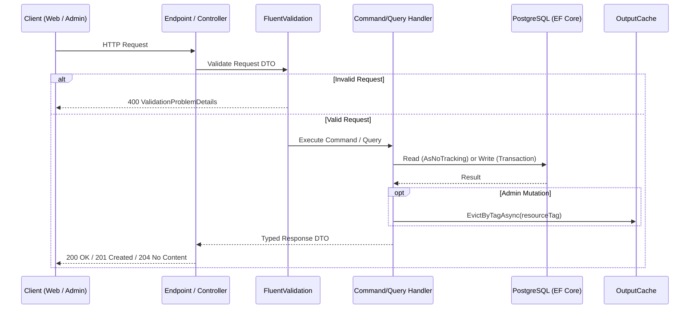

# Backend Software Architecture

**Application:** Portfolio REST API (`jobayer-portfolio-api`)  
**Framework:** ASP.NET Core Web API  
**Database:** PostgreSQL (`EF Core`)  
**Status:** Proposed Clean Architecture + CQRS

## 1. Architectural Goals
- Enforce a hard security and data-contract boundary between Public and Admin consumers.
- Keep domain rules (publication state validation, slug invariants, asset usage checks) independent of HTTP and database plumbing.
- Optimize public queries for low latency and aggressive caching while keeping admin commands transactional and auditable.

## 2. Solution Structure

```text
jobayer-portfolio-api/
├── AGENTS.md
├── README.md
├── API_PRD.md
├── docs/
│   ├── API_ENDPOINTS_AND_CONTRACTS.md
│   ├── AUTH_AND_SECURITY.md
│   ├── CACHING_AND_PERFORMANCE.md
│   ├── DATABASE_SCHEMA.md
│   ├── DECISIONS.md
│   ├── DEPLOYMENT.md
│   ├── ENVIRONMENT_AND_CONFIGURATION.md
│   ├── ERROR_HANDLING_AND_VALIDATION.md
│   ├── MEDIA_AND_FILE_STORAGE.md
│   ├── OBSERVABILITY_AND_LOGGING.md
│   ├── OPEN_QUESTIONS.md
│   ├── SOFTWARE_ARCHITECTURE.md
│   ├── TECH_STACK.md
│   └── TESTING_QA.md
├── docker-compose.yml
├── JobayerPortfolio.sln
├── src/
│   ├── Portfolio.Domain/
│   │   ├── Common/
│   │   ├── Entities/
│   │   ├── Enums/
│   │   └── Exceptions/
│   ├── Portfolio.Application/
│   │   ├── Common/
│   │   │   ├── Interfaces/
│   │   │   ├── Behaviors/
│   │   │   └── Models/
│   │   └── Features/
│   │       ├── Auth/
│   │       ├── Profile/
│   │       ├── Experiences/
│   │       ├── Projects/
│   │       ├── Skills/
│   │       ├── Educations/
│   │       ├── Publications/
│   │       ├── Certifications/
│   │       ├── Blog/
│   │       ├── Contact/
│   │       └── Media/
│   ├── Portfolio.Infrastructure/
│   │   ├── Persistence/
│   │   │   ├── PortfolioDbContext.cs
│   │   │   ├── Configurations/
│   │   │   └── Migrations/
│   │   ├── Identity/
│   │   ├── Storage/
│   │   └── Email/
│   └── Portfolio.Api/
│       ├── Endpoints/
│       │   ├── Public/
│       │   ├── Auth/
│       │   └── Admin/
│       ├── Middleware/
│       ├── Extensions/
│       └── Program.cs
└── tests/
    ├── Portfolio.UnitTests/
    └── Portfolio.IntegrationTests/
```

## 3. Request Processing Pipeline



## 4. Layer Responsibilities
- **`Portfolio.Domain`:** Entities, enums (`ContentStatus`), value objects, and domain invariants. Zero external package dependencies.
- **`Portfolio.Application`:** Feature vertical slices (Commands, Queries, DTOs, FluentValidation validators, and interfaces `IPortfolioDbContext`, `IFileStorageService`, `IEmailService`, `ITokenService`).
- **`Portfolio.Infrastructure`:** EF Core `PortfolioDbContext`, PostgreSQL configurations, JWT/refresh token implementation, file storage implementation, and email sender.
- **`Portfolio.Api`:** Minimal API route groups (or controllers), authentication/authorization wiring, rate limiting, `OutputCache`, OpenAPI generation, and `GlobalExceptionHandler`.
